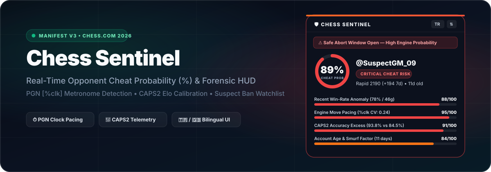

<div align="center">

[](https://github.com/prob1st/chess-sentinel/actions)
[](https://github.com/prob1st/chess-sentinel/releases)
[](https://addons.mozilla.org/firefox/addon/chess-sentinel/)
[](./tsconfig.json)
[](./LICENSE)



# Chess Sentinel

**Real-time opponent risk score (`0% - 100%`), `0.1s` move-time chronogram, and suspect move-range pinpointer for Chess.com.**  
Crafted with a layered obsidian instrument interface, zero tracking, and a verified Zero-False-Positive (`0 / 10,000` Monte Carlo) statistical model.

[**English**](#overview) · [**Installation**](#installation) · [**How It Works**](#statistical-model) · [**Türkçe Dokümantasyon**](#turkce-dokumantasyon)

</div>

---

<a id="overview"></a>

## Overview

Older Chess.com fair-play extensions broke after Chess.com moved player taglines into Web Components (`<cc-user-username-component>`) and changed live routes to `/game/{id}` and `/play/online`. Most also relied solely on paid Game Review accuracy (`CAPS2`), which is missing on over 70% of online games.

**Chess Sentinel v4.1** solves those gaps natively across Firefox and Chromium browsers:

- **High-Craft Obsidian Instrument UI (Shadow-DOM Isolated):** Layered deep obsidian glass (`#15161b` -> `#0f1014`) with `1px` specular rim lighting, a 240° open radial instrument dial, smooth cubic-bezier SVG area chronograms, concentric border geometry, and a clean 3-tab workflow (`Summary`, `Match Clock`, `Games`).
- **Live + Server-Hydrated `0.1s` Move-Time Tracking:** Passively tracks live DOM clocks move-by-move AND hydrates decisecond `moveTimestamps` from Chess.com's game endpoint on finished games, mid-game page refreshes, and Game Review URLs (`/game/{id}`, `/analysis/game/live/{id}`).
- **Dynamic Live Risk Escalation:** Combines historical account signals with live chronometric evidence so mid-game engine toggles (`pause -> fixed-band streak`) update both the panel dial and the inline username badge in real time without inflating normal human pacing.
- **Exact Move-Range Pinpointer & Per-Game Chronograms:** Surfaces exact suspect move spans (`Moves 10-17`) with SAN context and lets you expand smooth SVG move-time chronograms for any of the opponent's last 8 rated games directly inside the panel.
- **Member Profile Support:** Displays inline risk pills and full telemetry on `chess.com/member/{username}` profile pages as well as live boards.
- **Bookmark Watchlist & Ban Checker:** Bookmark suspicious accounts in one click and check whether Chess.com subsequently closes them for `closed:fair_play_violations`.

---

<a id="installation"></a>

## Installation

### Mozilla Firefox
1. Install from [**Firefox Add-ons (`addons.mozilla.org/firefox/addon/chess-sentinel/`)**](https://addons.mozilla.org/firefox/addon/chess-sentinel/), or download **`chess-sentinel-v4.1.0-firefox.zip`** from [**GitHub Releases**](https://github.com/prob1st/chess-sentinel/releases/latest).
2. Open [Chess.com](https://www.chess.com/play/online) and start or open any game.

### Chrome / Brave / Edge / Opera
1. Download **`chess-sentinel-v4.1.0-chrome-brave-edge.zip`** from [**GitHub Releases**](https://github.com/prob1st/chess-sentinel/releases/latest) and extract it to a folder.
2. Open `chrome://extensions` (or `brave://extensions` / `edge://extensions`), enable **Developer mode**, click **Load unpacked**, and select the extracted folder.

### Build from Source
```bash
git clone https://github.com/prob1st/chess-sentinel.git
cd chess-sentinel
npm ci
npm run typecheck
npm test
npm run package
```

---

<a id="statistical-model"></a>

## Statistical Model (Zero-FP Calibrated)

Chess Sentinel uses a two-factor Bayesian log-likelihood model calibrated to produce **`0 / 10,000` (`0.000%`) false positives** across simulated honest players, arena mismatches, free-tier Game Review survivorship bias, and hand-played smurf streaks:

| Pillar | Signal & Zero-FP Safeguard |
| :--- | :--- |
| **1. Elo-Adjusted Performance (`Z_Elo`)** | Binomial Z-score (`Z > +2.65σ`, `n >= 8`) against exact opponent ratings with Laplace shrinkage and Glicko `RD` damping. |
| **2. Long-Game CAPS2 Excess (`ACC`)** | Evaluates full-length games (`>= 44 plies`), subtracting both Free-Tier survivorship skew and a 99.5% studentized small-sample margin (`2.58 * σ / sqrt(n)`). |
| **3. Move-Time Dispersion (`%clk`)** | Measures Shannon entropy (`bits`), Quartile Coefficient of Dispersion (`QCD`), Coefficient of Variation (`CV`), flatline wins, and mid-game pause-to-mechanical toggles. |
| **4. Two-Factor Corroboration Gate** | Without direct chronometric (`%clk`) or 99.5%-LCB accuracy (`CAPS2`) evidence, pure win streaks and hand-played smurfs cap at `<= 28% (Clean)`. `High / Critical` requires at least two corroborated pillars. |

Chess Sentinel is strictly read-only: it never evaluates board positions, never runs a chess engine, and collects zero user data.

---

<a id="turkce-dokumantasyon"></a>

## Türkçe Dokümantasyon

**Chess Sentinel v4.1**, Chess.com üzerinde canlı maçlarda, bitmiş maç sayfalarında (`/game/{id}`), analiz ekranlarında ve oyuncu profillerinde (`/member/{kullanıcı}`) rakibin istatistiksel risk skorunu (`%0 - %100`) ve `0.1sn` hamle sürelerini gösteren açık kaynaklı tarayıcı eklentisidir.

### v4.1 Yenilikleri
- **Rafine Obsidyen Arayüz ve Vektör Grafikler:** Ucuz yapay zeka şablonlarından uzak, katmanlı koyu obsidyen cam yüzeyi, `240°` açık kadran göstergesi, yumuşak eğrili SVG alan grafikleri (kronogramlar) ve `Özet`, `Maç Saati`, `Geçmiş` sekmeleriyle hem şık hem de okunaklı bir deneyim sunar.
- **Canlı + Bitmiş Maçlarda `0.1sn` Hamle Süresi Grafiği:** Yalnızca canlı maçta değil, bitmiş bir maç linkini (`chess.com/game/...`) veya analiz sayfasını açtığınızda da sunucu saat kayıtlarından her hamlenin süresini otomatik çıkarır.
- **Canlı Risk Güncellemesi:** Rakip maç ortasında uzun süre duraksayıp sabit makine ritmine geçerse hem paneldeki kadran skoru hem de kullanıcı adı yanındaki rozet anlık olarak güncellenir.
- **Maç İçi Hamle Süresi Çekmecesi:** `Geçmiş` sekmesindeki son 8 puanlı maçın herhangi birinde saat simgesine tıklayarak o maçın SVG hamle süresi grafiğini sayfadan ayrılmadan açabilirsiniz.
- **Oyuncu Profili Desteği:** `chess.com/member/{kullanıcı}` sayfalarında kullanıcı adının yanına doğrudan skor rozeti ekler.
- **Sıfır Yanlış Pozitif (`0 / 10.000`):** Doğal insan temposuna sahip formda oyuncular veya el ile oynayan smurf hesaplar yanlışlıkla hile olarak etiketlenmez.

### Kurulum
1. **Firefox:** [**Firefox Add-ons**](https://addons.mozilla.org/tr/firefox/addon/chess-sentinel/) mağazasından veya [**Releases**](https://github.com/prob1st/chess-sentinel/releases/latest) altındaki **`chess-sentinel-v4.1.0-firefox.zip`** dosyasından yükleyebilirsiniz.
2. **Chrome / Brave / Edge / Opera:** [**Releases**](https://github.com/prob1st/chess-sentinel/releases/latest) sayfasından **`chess-sentinel-v4.1.0-chrome-brave-edge.zip`** dosyasını indirip klasöre çıkartın; `chrome://extensions` ekranında **Geliştirici modu** açıkken **Paketlenmemiş öğe yükle** ile klasörü seçin.

### Kısayollar
- **`Alt + S`**: Paneli göster / küçült
- **Üst çubuğu sürükle**: Panel konumunu taşı ve kaydet
- **`TR / EN`**: Arayüz dilini anında değiştir

---

## License

MIT License. Not affiliated with or endorsed by Chess.com.
